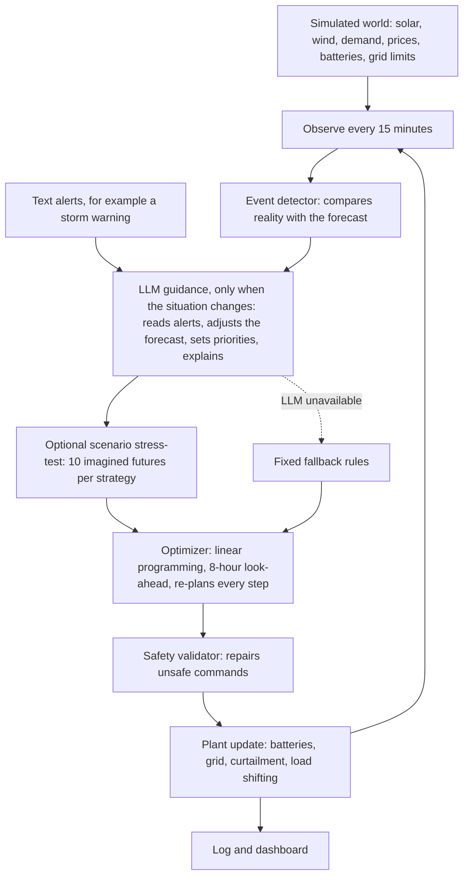

# Renewable Energy Orchestrator

An AI agent that runs a small renewable-energy portfolio. Every 15 minutes it decides how to use solar, wind, batteries, the grid and flexible industrial load, reacts to surprises (clouds, price spikes, battery outages, line limits, storms), reads text alerts, and explains what it did in plain English.

Built for the **ET AI Hackathon: Agentic Edition**, Problem 4 (Utilities: Renewable Energy Orchestrator).

- Demo video: *TODO: add link*
- Pitch deck: *TODO: add link*

---

## 1. Declared position on the 3x3 grid

| Axis | Claimed level | Evidence in this repository |
|---|---|---|
| Solution features | **F3** | F1: the optimizer chooses a full bundle of actions each step (batteries, grid, curtailment, load shift). F2: the agent chooses its priorities for the situation and stress-tests strategies under uncertainty. F3: scenario simulation over time with varied conditions (15 random days, and 10 imagined futures per strategy). |
| Solution depth | **D2** | Structured numeric data plus unstructured text alerts. Reliability is shown over 15 random days (the agent beats the baseline on all 15) and by safety, fallback and fault-tolerance mechanisms. |

We do **not** claim D3: there is no image, audio or other multimodal input.

---

## 2. How it works



**Design principle: the LLM never sets power levels.** A mathematical optimizer computes every number. The LLM does what language models are good at: reading text alerts, turning them into forecast changes ("wind drops to 15 percent from 18:00 for 3 hours"), choosing the priorities for the situation, and explaining the decision. Its answer is parsed, checked and clamped to safe ranges before use. If the LLM is down or answers badly, fixed rules take over and the system keeps running.

### The loop, step by step

1. **Observe**: solar, wind, demand, price, line limit, battery availability.
2. **Detect surprises** (`events.py`): compares what happens with what was forecast.
3. **Ask the LLM** (`agent.py`, `llm.py`): only when the situation changes. It returns JSON with a mode, three priority weights, forecast adjustments and an explanation.
4. **Stress-test (optional, `scenarios.py`)**: tries several battery-reserve strategies on imagined futures built only from the agent's own forecast (never from the real future) and keeps the proposal unless another strategy is clearly better. Score = average cost + 0.5 x (average of the worst 20 percent - average).
5. **Optimize** (`optimizer.py`): a linear program over the next 8 hours decides battery charge and discharge, grid import and export, curtailment and industrial load shifting. It re-plans at every step, so it reacts to surprises.
6. **Validate** (`validator.py`): re-checks every command against hard limits and repairs anything unsafe.
7. **Act and log** (`dispatch.py`): updates the plant and records every decision.

### How conflicting goals are resolved

Every goal is turned into a dollar cost, and the optimizer minimizes the total:

`energy cost + carbon cost + curtailment penalty + battery degradation + load-shifting cost + unserved-demand penalty`

| Item | Value used |
|---|---|
| Carbon price | $50 per tonne (LLM may change it within 20 to 200) |
| Curtailment penalty | $20 per MWh of clean energy wasted (LLM range 5 to 100) |
| Battery degradation | $4 per MWh of throughput |
| Load shifting | $15 per MWh postponed |
| Unserved demand | $1,000 per MWh |
| Value of stored energy | 0.9 x average price (LLM range 0.5 to 2.5). Raising it keeps a reserve for emergencies. |

Hard limits (battery power and energy, line capacity, export limit, and the shiftable share of load) are never violated. All weights live in `config.py`.

---

## 3. What is covered from the problem statement

| Area | Covered | Not covered |
|---|---|---|
| Generation | Solar and wind output, and forecasts whose error grows with lead time | Individual farms are modeled in aggregate (5 solar and 3 wind farms are summed; curtailment is also aggregate) |
| Grid | Demand and forecast, import and export limits, line derating events | Grid frequency |
| Batteries | Two batteries with state of charge, efficiency, maximum power, degradation cost, outages | |
| Market | Electricity price, carbon price times time-varying carbon intensity | Demand-response incentive payments as a separate market signal |
| External | Storm alerts as free text read by the LLM | Raw weather-forecast data, maintenance schedules |
| Actions | Charge, discharge, reserve capacity, buy, sell, hold energy until prices rise, curtail, prefer cleaner supply, shift industrial load | Reducing non-critical loads as a separate action, maintenance actions (delay, schedule, dispatch inspection teams) |
| Objectives | Cost, carbon, curtailment, battery degradation, reliability, renewable use, profit | A separate grid-stability objective beyond line limits |

---

## 4. Results

All data is **simulated**. Runs are deterministic (fixed seeds), so you can reproduce every number below. The **baseline** is a simple rule-of-thumb controller written for this project (charge on surplus, discharge when the price is high or the line is full). It is not an industry benchmark.

| Test | Baseline | Optimizer | Agent |
|---|---|---|---|
| Four-event day: total cost | $255,182 | $202,068 (-20.8%) | not run |
| Storm day (stand-in LLM): total cost | $380,117 | $333,294 (-12.3%) | $329,399 (-13.3%) |
| Storm day: unserved demand | 210 MWh | 154 MWh | 149 MWh |
| Storm day: CO2 from imports | 786 t | 819 t | 822 t |
| 15 random days: average cost | $194,376 | $142,150 (-26.9%) | $142,005 (rules-only agent) |
| 15 random days: worst day | $272,899 | $225,063 | $225,063 |
| 15 random days: days beating the baseline | | 15 of 15 | 15 of 15 |
| 15 random days: average unserved demand | 66.3 MWh | 15.8 MWh | 15.9 MWh |
| Storm day with scenario stress-test | | | $324,069 (vs $329,399 without) |

**Real LLM run:** *TODO: add your own numbers from a Real LLM run (Gemini) here.*

Notes for reading these numbers honestly:

- The "Agent" in the storm-day row uses a **stand-in LLM** (a small function in `test_agent.py` that answers the way a good LLM should), so that tests run without an API key. Results with a real LLM depend on what that LLM decides.
- On the storm day the agent imports slightly **more** grid power than the baseline (+36 t CO2). It serves more demand and costs less, and carbon is priced at $50 per tonne inside the objective, so this is a deliberate trade-off. Raise `carbon_price` to weigh emissions more.
- The storm day is deliberately harsh. Part of the shortfall is physically unavoidable with the assets modeled, so even a perfect controller would leave demand unserved.
- The scenario stress-test helps only a little (about 1.6 percent on the storm day), because at the moment of decision the batteries are already full and strategies barely differ.

---

## 5. Safety, reliability and responsible AI

- **LLM output is untrusted.** It is parsed as JSON, unknown modes and series are dropped, weights and forecast factors are clamped to fixed ranges, and at most four adjustments are accepted.
- **Fallback rules.** If the LLM is unreachable, rate-limited or returns garbage, the agent switches to fixed rules and the dashboard says so (`source: rules`).
- **Safety validator.** Every command is re-checked: offline batteries, power limits, available energy, free capacity, curtailment limits, shiftable-load limits, and the rule "never waste clean energy while importing". Repairs are logged.
- **Solver failure handling.** If the optimizer cannot find a plan, the baseline rules take over for that step.
- **No peeking.** Imagined futures for stress-testing are built from the agent's own forecast and current observations only.
- **Human oversight.** Every LLM consultation is shown in the dashboard with the situation it saw, its answer and its explanation.
- **Secrets.** API keys are read from a `.env` file that is excluded from git.
- **Honest accounting.** Postponed industrial load that is never caught up counts as unserved demand, so load shifting cannot fake savings.

---

## 6. Run it

Requires Python 3.10 or newer.

```bash
pip install -r requirements.txt
```

### Optional: connect a real LLM

Create a file named `.env` in the project folder:

```
GEMINI_API_KEY=your-key-here
```

Then set `PROVIDER` (and, if needed, the model name) at the top of `llm.py`. Anthropic (`ANTHROPIC_API_KEY`) and OpenAI (`OPENAI_API_KEY`) are also supported. Model names change, so copy the exact name from your provider.

Notes:

- Free API plans have small quotas. For example, a free Gemini key may allow only about 20 requests per day for a model. A full real-LLM run of the storm day uses about 12 requests.
- Every successful LLM answer is saved in `llm_cache.json`. Asking the same question again reuses the saved answer and uses no quota, which makes demos repeatable. A cached answer is still shown as `source: llm`.
- Everything works without any API key by choosing **Stand-in LLM** or **Rules only** in the dashboard.

### Dashboard

```bash
streamlit run app.py
```

Choose a day (storm day, random day, or custom surprises), optionally edit the text alert, pick the controller, and press **Run simulation**. Scrub through the day to see the situation, the agent's action and the LLM's reasoning.

### Tests and experiments

```bash
python test_sim.py          # plots the simulated day
python test_baseline.py     # baseline controller results
python test_optimizer.py    # baseline vs optimizer
python test_safety.py       # the validator repairing unsafe commands
python test_agent.py        # storm day with the stand-in LLM (add "live" for a real LLM)
python test_scenarios.py    # 15 random days and the scenario stress-test (about 1-2 minutes)
python test_llm_once.py     # checks that your LLM key and model work
```

---

## 7. Project structure

| File | Purpose |
|---|---|
| `config.py` | Assets, limits and all cost settings |
| `simulator.py` | Simulated 24-hour world with injectable surprises |
| `dispatch.py` | Applies one decision for 15 minutes, scores it, runs a whole day |
| `baseline.py` | Simple rule-of-thumb controller used for comparison |
| `optimizer.py` | Linear-programming planner with an 8-hour look-ahead |
| `validator.py` | Safety layer that repairs unsafe commands |
| `events.py` | Detects surprises by comparing reality with the forecast |
| `llm.py` | LLM access with retries, request spacing and an answer cache |
| `agent.py` | Prompts the LLM, validates its answer, falls back to rules, runs the loop |
| `scenarios.py` | Imagined futures and strategy stress-testing |
| `montecarlo.py` | Random test days |
| `dashboard_data.py`, `app.py` | Streamlit dashboard |
| `test_*.py` | Tests and experiments |

---

## 8. Limitations

- All data is simulated, with simple shapes for sun, wind, demand and prices. Real forecasts, market rules and grid physics are far more complex.
- Farms are aggregated for generation and curtailment, and the grid is a single connection with import and export limits (no frequency, no network model).
- The optimizer is a linear program with efficiencies and costs fixed at the values in `config.py`; battery ageing is a simple cost per MWh.
- Events and surprises are injected in the simulator. The detector compares against the pre-surprise forecast.
- The agent's gain over a simple baseline depends on the baseline chosen.
- Maintenance planning, frequency control and multi-site coordination are not implemented.
